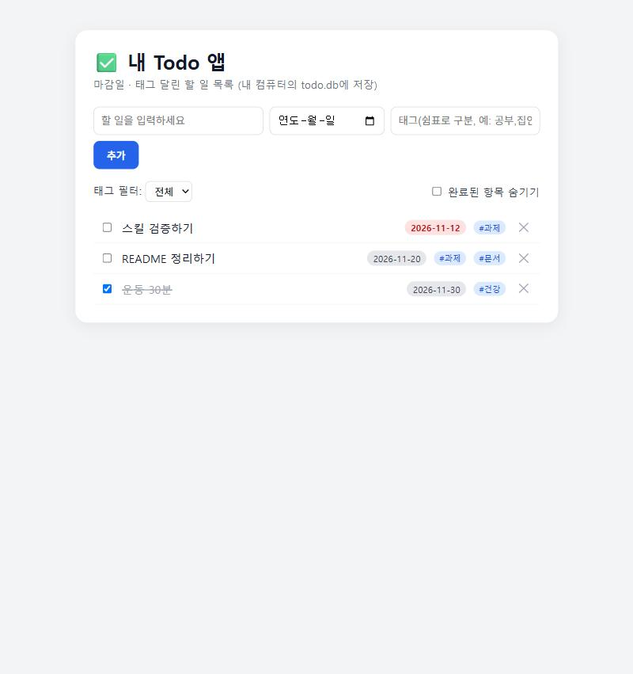

# 내 Todo 앱 (길 A: 로컬 SQLite + 길 B: Supabase)

AIFFEL 04 노드 실습 — 새로고침해도, 서버를 껐다 켜도 남는 Todo 앱입니다.

## 실행 방법
```bash
npm install
npm start
```
브라우저에서 http://localhost:3100 을 엽니다.

## 구성
- `server.js` — Express 백엔드. `/api/todos`, `/api/tags`에서만 DB에 접근합니다.
- `db.js` — Node.js 내장 `node:sqlite`로 `todo.db` 파일을 만들고 관리합니다.
  - 처음에 `better-sqlite3`를 쓰려다 Visual Studio 빌드 도구가 없어 설치가 막혔습니다.
    Node 22.5+에 내장된 `node:sqlite`로 바꿔 빌드 없이 해결했습니다.
- `public/` — 화면(프론트). API에만 요청하고 DB는 직접 건드리지 않습니다.
- `PRD.md`, `DB-구조.md` — 기획과 DB 설계 문서.

## 기본 기능 + 내가 넣은 기능
- CRUD: 할 일 추가 / 목록 보기 / 완료 표시 / 삭제
- 마감일: 지난 마감일은 빨간 배지로 표시
- 태그(다대다): 할 일 하나에 태그 여러 개, 태그로 목록 필터링

## 확인한 것 (실제로 테스트함)
- [x] 추가 → 새로고침해도 남음
- [x] 서버를 완전히 껐다 다시 켜도 `todo.db`에서 그대로 읽어 옴
- [x] 완료 체크, 마감일 지난 항목 빨간 표시, 태그 여러 개 표시
- [x] 삭제 정상 동작
- [x] `todo.db` 파일을 직접 열어 행이 실제로 쌓이는 것 확인

## 작동 화면 (길 A, 로컬 SQLite)
깨끗한 DB로 앱을 새로 띄워 같은 순서로 찍었습니다. 화면의 할 일은 시연용 예시입니다.

| 순서 | 장면 | 파일 |
|---|---|---|
| 1 | 할 일 3개를 마감일·태그와 함께 추가. 지난 마감일(11/12)은 빨간 배지 | `screenshots/01-추가-마감일-태그.jpg` |
| 2 | 하나를 완료로 체크 | `screenshots/02-완료-체크.jpg` |
| 3 | **서버 프로세스를 종료했다가 다시 시작한 뒤** 새로고침 — 3개와 완료 상태가 그대로 | `screenshots/03-서버-껐다-켠-뒤에도-남음.jpg` |
| 4 | 하나를 삭제 | `screenshots/04-삭제.jpg` |




길 B(Supabase)는 로그인 정보가 들어 있는 화면이라 캡처를 올리지 않았습니다. 대신 확인 항목과 결과를 `전환-확인-기록.md`에 적었고, 두 계정으로 서로의 데이터가 안 보이는지 `node scripts/rls-check.js`(13개 항목)로 다시 돌려 볼 수 있습니다.

## 길 B (Supabase로 전환)
코드는 이미 두 저장소를 지원합니다. `.env`에 `SUPABASE_URL`과 `SUPABASE_ANON_KEY`가 있으면 Supabase 모드(로그인 + RLS), 비어 있으면 로컬 SQLite 모드로 동작합니다.
- `store-sqlite.js` / `store-supabase.js` — 같은 함수 모양의 데이터 계층 두 개
- `supabase-schema.sql` — 표 3개와 RLS 정책 (Supabase SQL Editor에서 실행)
- `SUPABASE-전환.md` — 가입과 키 발급 순서, `전환-확인-기록.md` — 확인 체크리스트
- 서버는 로그인 사용자의 토큰으로 DB에 접근하므로 RLS가 적용됩니다(`service_role` 키는 쓰지 않음).
- 확인 상태: 로컬(길 A)과 Supabase(길 B) 모두 확인 완료. 결과는 `전환-확인-기록.md`, 검증 스크립트는 `node scripts/rls-check.js`.

## CLI
`node todo.js list | add "<내용>" | done <번호> | summary` (로컬 SQLite 전용)
